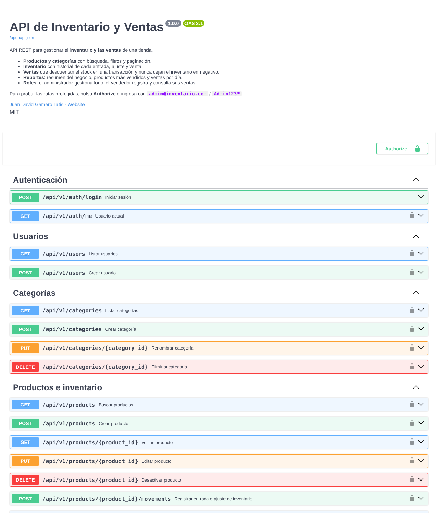
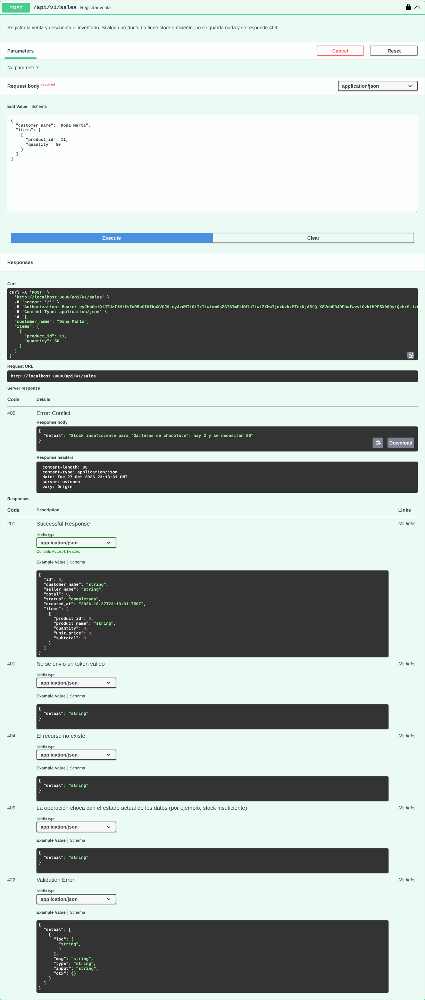
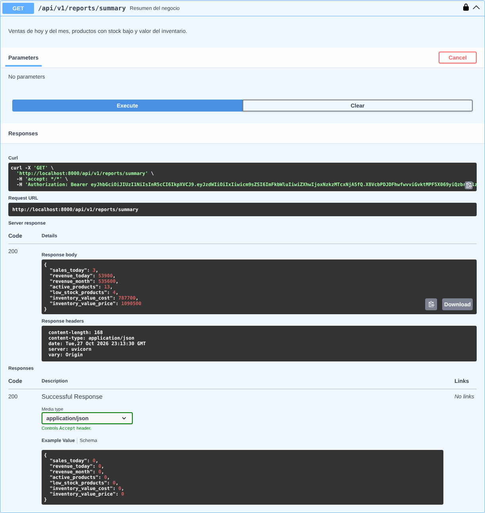
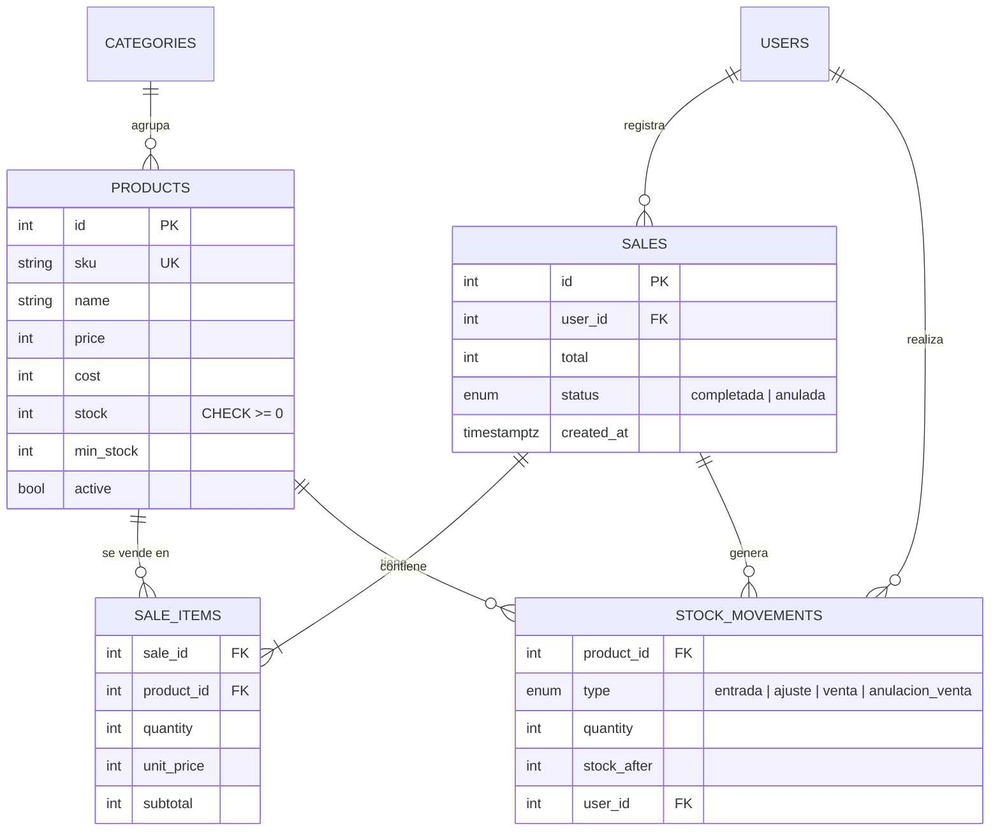

# API de Inventario y Ventas

[](https://github.com/jgamerot07-prog/api-inventario-python/actions/workflows/ci.yml)


API REST para gestionar el **inventario y las ventas de una tienda**: productos, categorías, entradas de mercancía,
ventas que descuentan el stock automáticamente y reportes del negocio. Incluye usuarios con roles y
documentación interactiva con Swagger, donde se puede probar cada ruta desde el navegador.



## Contenido

- [Funcionalidades](#funcionalidades)
- [Tecnologías](#tecnologías)
- [Decisiones técnicas](#decisiones-técnicas)
- [Modelo de datos](#modelo-de-datos)
- [Endpoints](#endpoints)
- [Cómo ejecutarlo](#cómo-ejecutarlo)
- [Pruebas](#pruebas)
- [Despliegue](#despliegue)
- [Próximas mejoras](#próximas-mejoras)

## Funcionalidades

- **Productos y categorías**: búsqueda por nombre o SKU, filtros, paginación y alerta de stock bajo.
- **Inventario con historial**: cada entrada, ajuste, venta o anulación queda registrada con usuario, fecha y stock resultante.
- **Ventas**: descuentan el inventario en una sola transacción. Si un producto no alcanza, no se guarda nada.
- **Anulación de ventas**: devuelve las unidades al inventario y deja el registro.
- **Reportes**: ventas de hoy y del mes, valor del inventario, productos más vendidos y ventas por día.
- **Roles**: el **administrador** gestiona todo; el **vendedor** registra ventas y solo ve las suyas.

| Venta rechazada por falta de stock | Resumen del negocio |
| --- | --- |
|  |  |

## Tecnologías

| Área | Herramientas |
| --- | --- |
| Lenguaje y framework | Python 3.13, FastAPI |
| Base de datos | PostgreSQL 16, SQLAlchemy 2 (ORM), Alembic (migraciones) |
| Validación | Pydantic 2 |
| Seguridad | JWT (OAuth2 con contraseña), bcrypt, roles por ruta |
| Calidad | Pytest (32 pruebas, 93 % de cobertura), Ruff (linter y formato) |
| DevOps | Docker, Docker Compose, GitHub Actions, Render |

## Decisiones técnicas

**1. El inventario nunca queda en negativo, ni siquiera con ventas simultáneas.**
Si dos cajeros venden la última unidad al mismo tiempo, revisar el stock en el código no basta: ambos ven
"hay 1" y los dos venden. Para evitarlo, la venta bloquea las filas de los productos con `SELECT ... FOR UPDATE`,
así la segunda venta espera a que termine la primera y ve el stock ya actualizado.
Los productos se bloquean siempre en el mismo orden (por id) para que dos ventas nunca se queden esperándose entre sí.
Como segunda protección, la tabla tiene la restricción `CHECK (stock >= 0)`. Hay una prueba automática que lanza
dos ventas en paralelo y verifica que solo una pase.

**2. Las ventas son "todo o nada".**
Una venta con varios productos se guarda en una sola transacción: si el último producto no tiene stock,
se revierte todo y ningún producto se descuenta.

**3. El precio lo pone el servidor.**
El cliente solo envía qué productos y cuántas unidades. El precio y el total se calculan en el servidor y el precio
de cada línea se guarda en la venta, para que un cambio de precio posterior no altere ventas pasadas.

**4. El stock solo cambia con movimientos.**
Editar un producto no cambia su stock. Las unidades solo entran o salen mediante movimientos
(entrada, ajuste, venta o anulación), y cada uno queda en el historial. Así siempre se puede saber por qué cambió.

**5. Fechas con zona horaria.**
Las fechas se guardan como `TIMESTAMPTZ` y los reportes agrupan por día en hora de Colombia,
aunque el servidor esté en otro país.

## Modelo de datos



## Endpoints

Base: `/api/v1`. 🔒 = requiere token. 👑 = solo administrador.

| Método | Ruta | Descripción |
| --- | --- | --- |
| `POST` | `/auth/login` | Iniciar sesión (devuelve un token JWT) |
| `GET` | `/auth/me` 🔒 | Usuario actual |
| `GET` `POST` | `/users` 👑 | Listar y crear usuarios |
| `GET` | `/categories` 🔒 | Listar categorías |
| `POST` `PUT` `DELETE` | `/categories` 👑 | Crear, renombrar y eliminar categorías |
| `GET` | `/products?q=&category_id=&low_stock=&limit=&offset=` 🔒 | Buscar productos |
| `GET` | `/products/{id}` 🔒 | Ver un producto |
| `POST` `PUT` `DELETE` | `/products` 👑 | Crear, editar y desactivar productos |
| `POST` | `/products/{id}/movements` 👑 | Registrar entrada o ajuste de inventario |
| `GET` | `/products/{id}/movements` 🔒 | Historial de inventario |
| `POST` | `/sales` 🔒 | Registrar una venta |
| `GET` | `/sales?date_from=&date_to=&status=` 🔒 | Listar ventas |
| `GET` | `/sales/{id}` 🔒 | Ver una venta |
| `POST` | `/sales/{id}/cancel` 👑 | Anular una venta |
| `GET` | `/reports/summary` 👑 | Resumen del negocio |
| `GET` | `/reports/top-products?days=30` 👑 | Productos más vendidos |
| `GET` | `/reports/sales-by-day?days=7` 👑 | Ventas por día |

Ejemplo de venta:

```http
POST /api/v1/sales
Authorization: Bearer <token>
Content-Type: application/json

{
  "customer_name": "Doña Marta",
  "items": [
    { "product_id": 7, "quantity": 2 },
    { "product_id": 4, "quantity": 1 }
  ]
}
```

## Cómo ejecutarlo

### Opción 1: con Docker (lo más rápido)

```bash
git clone https://github.com/jgamerot07-prog/api-inventario-python.git
cd api-inventario-python
docker compose up --build
```

Abre **http://localhost:8000/docs**. Se cargan datos de ejemplo de una tienda de barrio.

### Opción 2: con Python

Requisitos: Python 3.12 o superior y PostgreSQL.

```bash
python -m venv .venv
source .venv/bin/activate          # En Windows: .venv\Scripts\activate
pip install -r requirements-dev.txt
cp .env.example .env               # Ajusta DATABASE_URL si es necesario

alembic upgrade head               # Crea las tablas
python -m app.seed --with-sales    # Datos de ejemplo (opcional)
uvicorn app.main:app --reload      # http://localhost:8000/docs
```

### Usuarios de ejemplo

| Rol | Correo | Contraseña |
| --- | --- | --- |
| Administrador | `admin@inventario.com` | `Admin123*` |
| Vendedor | `vendedor@inventario.com` | `Vendedor123*` |

En Swagger, pulsa **Authorize** e ingresa el correo en el campo `username`.

## Pruebas

```bash
pytest --cov=app
```

Las 32 pruebas corren contra PostgreSQL real (no una base simulada) y crean el esquema con las mismas migraciones
de Alembic que se usan en producción. Cubren autenticación y permisos por rol, validaciones,
stock que no puede quedar en negativo, ventas "todo o nada", anulaciones, reportes y **dos ventas simultáneas
del último producto**. GitHub Actions ejecuta el linter y las pruebas en cada `push`.

## Despliegue

El archivo `render.yaml` crea en [Render](https://render.com) la API y la base de datos PostgreSQL.
Al arrancar, `scripts/start.sh` aplica las migraciones y carga los datos de ejemplo.
La URL de la base de datos que entrega Render (`postgres://...`) se convierte automáticamente al formato de SQLAlchemy.

## Próximas mejoras

- Proveedores y órdenes de compra.
- Exportar reportes a Excel.
- Alertas por correo cuando un producto llega al stock mínimo.
- Lectura de productos con código de barras.

## Estructura del proyecto

```
├── app/
│   ├── api/
│   │   ├── deps.py        # Sesión de base de datos, usuario actual y permisos
│   │   └── routes/        # Endpoints por módulo
│   ├── core/              # Configuración, seguridad y errores
│   ├── models/            # Tablas (SQLAlchemy)
│   ├── schemas/           # Validación de entrada y salida (Pydantic)
│   ├── services/          # Lógica de inventario, ventas y reportes
│   ├── db.py
│   ├── main.py
│   └── seed.py            # Datos de ejemplo
├── alembic/               # Migraciones de la base de datos
├── tests/                 # Pruebas automáticas
├── scripts/start.sh       # Arranque en Docker y Render
├── Dockerfile
└── docker-compose.yml
```

## Autor

**Juan David Gamero Tatis** · Estudiante de Tecnología en Desarrollo de Software, Universidad de la Costa (CUC)

[LinkedIn](https://linkedin.com/in/juangamero07) · [GitHub](https://github.com/jgamerot07-prog)
